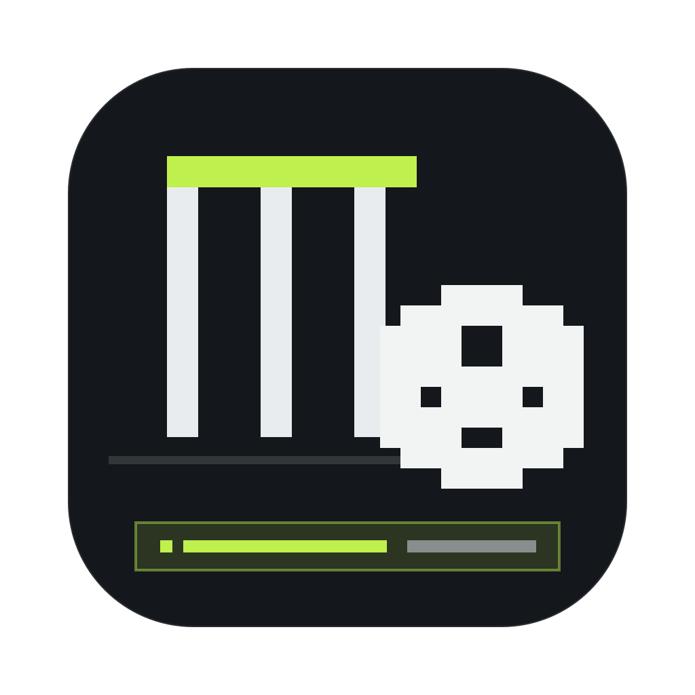
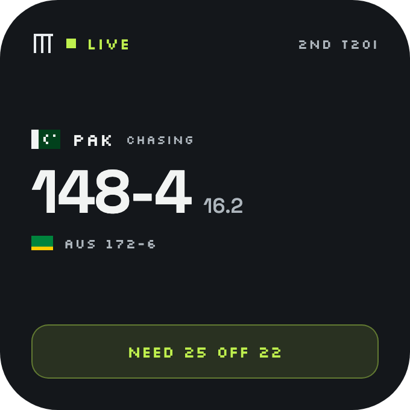
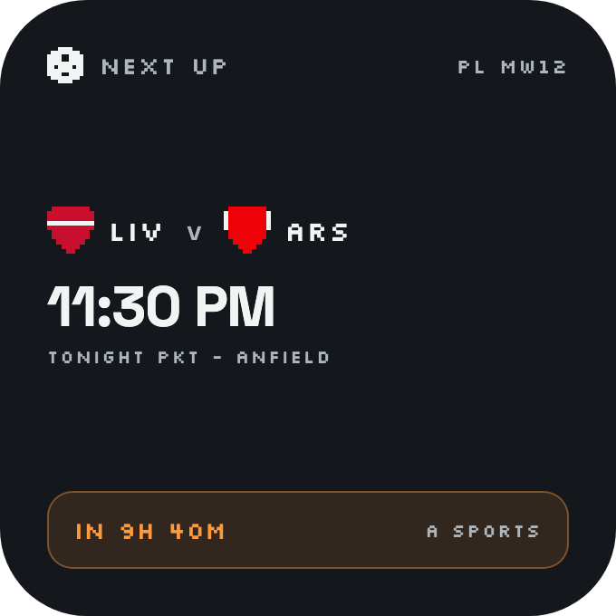
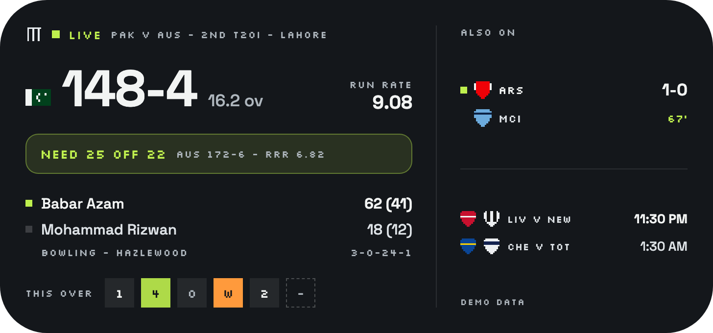
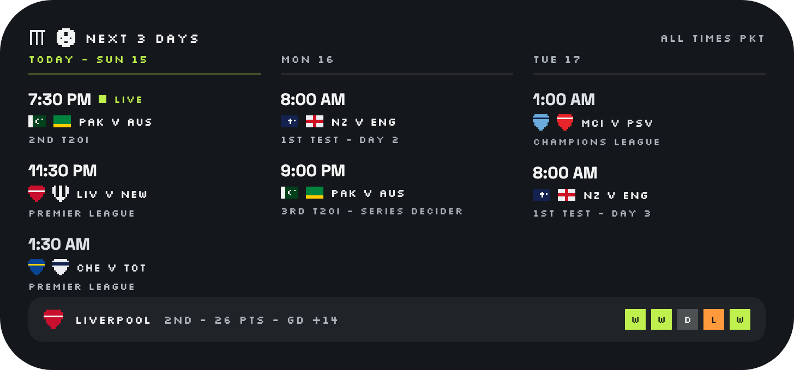

# Match Day

Live cricket and football scores on your Mac desktop, in a little pixel-art widget.

When a match you follow is on, Match Day shows the score and what's at stake: runs needed off balls remaining, who's on strike, this over ball by ball. When nothing's on, it switches to the next match with a countdown, or the next three days of fixtures with your club's league position underneath.

*Inspired by my husband, [@arhamlet](https://github.com/arhamlet), who always has a match on: this was made for him.*

| Small · live | Small · next up |
|---|---|
|  |  |





*Screenshots use the built-in demo data.*

## What it shows

**Small (340 × 340)**
- **Live:** batting side, score and overs, the other side's total, and the one number that matters right now: *NEED 25 OFF 22* in a chase, or the lead/deficit in a Test. Football shows both scores and the minute.
- **Next up:** the next match for a team you follow, kickoff time, venue and a countdown.

**Medium (728 × 340)**
- **Live:** score, run rate, the chase equation and required rate, both batters, the bowler's figures, this over ball by ball, plus other live matches and what's still to come today.
- **Next 3 days:** fixtures grouped by day, with your club's position, points, goal difference and last five results pinned underneath.

It switches between live and idle on its own, refreshing every 30 seconds while a match is on and every 5 minutes otherwise.

Out of the box it follows **Pakistan** in cricket (plus men's internationals between the full-member nations), the **Premier League** and **Champions League**, and **Liverpool** for the next-match and league-table views. All of it is configurable (below).

## Requirements

- macOS 14 (Sonoma) or later
- Xcode or the Xcode Command Line Tools (`xcode-select --install`)
- An internet connection (scores come from ESPN's public scoreboard feeds, no account or API key needed)

## Setup

### 1. Get the code

```bash
git clone https://github.com/Maham-Anwaar/match-day-widget.git
cd match-day-widget
```

### 2. Build and install

```bash
./build.sh
```

This compiles the app and installs it to `/Applications/Match Day.app`. If you have an Apple Development certificate in your keychain it's used for signing (macOS may ask once for your keychain password: choose **Always Allow**); otherwise the app is signed locally.

### 3. Open it

```bash
open /Applications/"Match Day.app"
```

The first time, macOS asks whether Match Day can access your **Documents** folder: click **Allow** (its settings live in `Documents/Match Day`).

The widget appears in the top-right corner of your desktop, and a **court icon** appears in the menu bar.

## Using it

- **Move it:** drag it anywhere. It remembers where you put it.
- **Menu bar:**
  - **Size:** Small or Medium.
  - **Show:** Automatic (live when something's on), or pin it to the live or the idle view.
  - **Scale:** 100%, 75% (the default) or 50% of the design size.
  - **Demo data:** shows the sample match from the screenshots, handy when nothing's on.
  - **Keep on desktop:** pinned behind your windows like a widget; turn it off to float it above them.
  - **Open at login**, **Reset position**, **Edit settings…**, **Reload settings**, **Refresh**, **Quit**.

## Settings

`~/Documents/Match Day/config.json` is created on first launch. Open it with **Edit settings…**, save, then choose **Reload settings**.

```json
{
  "size": "small",
  "view": "auto",
  "scale": 0.75,
  "accent": "#BFF04E",
  "demo": false,
  "keepOnDesktop": true,
  "cricketTeams": ["PAK"],
  "internationalCricket": true,
  "footballLeagues": ["eng.1", "uefa.champions"],
  "favoriteTeam": { "league": "eng.1", "id": "364" },
  "timeZoneLabel": ""
}
```

| Key | What it does |
|---|---|
| `cricketTeams` | Cricket teams you follow, by ESPN abbreviation (`PAK`, `IND`, `AUS`, `ENG`, `NZ`, `SA`, `SL`, `WI`, `BAN`, `AFG`, `IRE`, `ZIM`…). Their live matches always take priority, and their next match shows in *Next up*. |
| `internationalCricket` | Also show men's internationals between the full-member nations. |
| `footballLeagues` | ESPN league codes for live scores and fixtures: `eng.1` Premier League, `uefa.champions` Champions League, `esp.1` La Liga, `ger.1` Bundesliga, `ita.1` Serie A, `fra.1` Ligue 1, `uefa.europa` Europa League. |
| `favoriteTeam` | Your club: its next match shows in *Next up* and its league row under the fixtures. `id` is the number in the club's ESPN URL (e.g. `espn.com/soccer/club/_/id/364/liverpool` → `364`); `league` is its league code. |
| `accent` | Highlight color. The design's options: `#BFF04E`, `#FF9A3C`, `#5BC0FF`, `#F2F4F3`. |
| `timeZoneLabel` | Text after "ALL TIMES" (e.g. `"PKT"`). Empty uses your Mac's time zone name. Times are always shown in your Mac's time zone. |
| `size`, `view`, `scale`, `demo`, `keepOnDesktop` | Same as the menu bar options. |

## Preview without installing

`widget.html` runs in any browser, which is handy for tweaking the design:

```bash
python3 -m http.server 8000
```

Then open `http://localhost:8000/widget.html?demo=1&size=medium&view=live` (drop `demo=1` for real scores; `view` can be `live` or `idle`, `size` `small` or `medium`).

## Project layout

| File | What it is |
|---|---|
| `widget.html` | The widget: all four layouts, pixel flags and crests, and fetching/parsing the live scores |
| `main.swift` | The macOS app: desktop-level window, menu bar, settings |
| `build.sh` | Compiles, signs and installs the app |

## Uninstall

Quit from the menu bar, then:

```bash
rm -rf /Applications/"Match Day.app" ~/Documents/"Match Day"
```

## Troubleshooting

- **"OFFLINE - RETRYING":** check your internet connection; it retries every minute, or use **Refresh**.
- **Nothing for my team:** check the abbreviation or club id in your settings, then **Reload settings**. Between seasons or during international breaks there may simply be no fixtures in the next few days.
- **Lost the widget off-screen:** **Reset position**.

## Notes

- Scores come from ESPN's public, unofficial scoreboard feeds. They're free and need no key, but they aren't a documented API and could change. This project isn't affiliated with or endorsed by ESPN.
- Flags and club crests are simple pixel-art shapes in team colors, not official logos.
- Fonts: [Space Grotesk](https://fonts.google.com/specimen/Space+Grotesk) and [Silkscreen](https://fonts.google.com/specimen/Silkscreen) via Google Fonts.

## License

[MIT](LICENSE)
